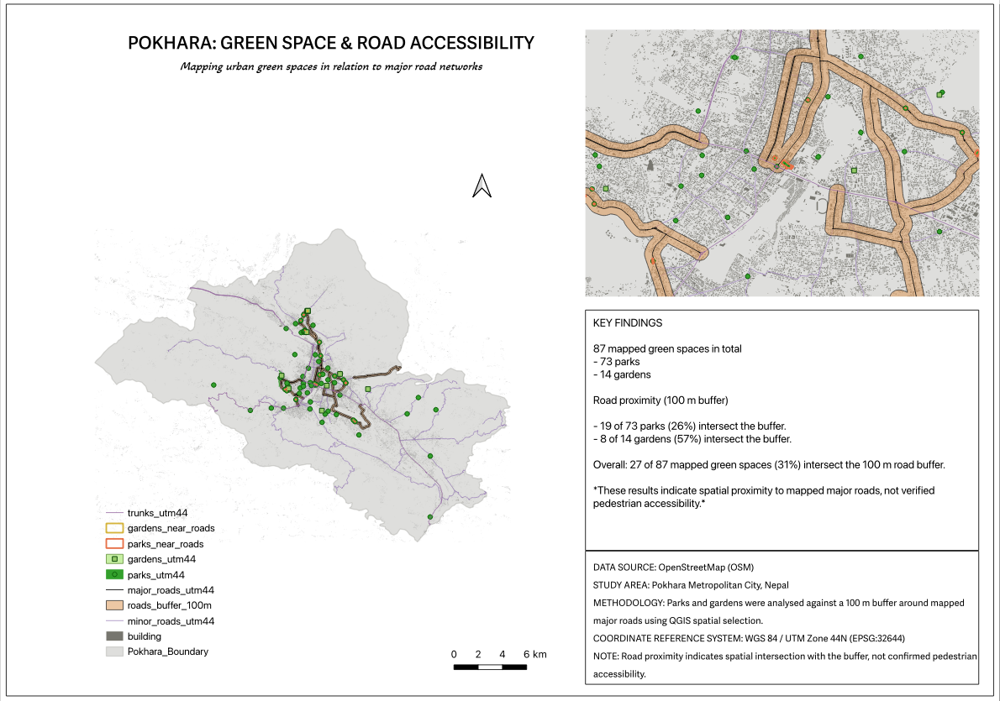

# Pokhara Green Space & Road Proximity Analysis

**Project type:** Urban GIS / Spatial Analysis  
**Location:** Pokhara Metropolitan City, Nepal  
**Software:** QGIS 3.44



## 1. Project Overview

This project examines the spatial distribution of mapped parks and gardens in Pokhara and investigates their proximity to major road networks.

A 100-metre buffer was created around mapped major roads to identify green spaces intersecting the buffer.

## 2. Research Question

How are mapped parks and gardens distributed in relation to major roads in Pokhara?

## 3. Data

- Pokhara municipal boundary
- OpenStreetMap-derived park and garden polygons
- OpenStreetMap-derived major road data
- Building footprints for the detailed urban map

## 4. Methodology

1. Collected and prepared spatial datasets.
2. Clipped relevant features to the Pokhara study area.
3. Reprojected analysis layers to EPSG:32644.
4. Created a dissolved 100-metre buffer around major roads.
5. Used spatial selection to identify parks and gardens intersecting the buffer.
6. Calculated the proportions of mapped green spaces intersecting the buffer.
7. Designed a two-scale thematic map in QGIS Print Layout.

See [documentation/methodology.md](documentation/methodology.md) for the full workflow.

## 5. Results

| Category | Total | Within buffer | Percentage |
|---|---:|---:|---:|
| Parks | 73 | 19 | 26.03% |
| Gardens | 14 | 8 | 57.14% |
| Combined | 87 | 27 | 31.03% |

See [data/analysis/analysis.md](data/analysis/analysis.md) for the detailed analysis.

## 6. Interpretation

Of the 87 mapped green spaces, 27 intersect the 100-metre buffer around mapped major roads.

A higher proportion of mapped gardens than parks intersected the buffer. This describes spatial proximity, not confirmed pedestrian accessibility.

## 7. Limitations

- OpenStreetMap data may not include every existing park, garden or road.
- The analysis uses feature counts rather than green-space area.
- A polygon intersecting the buffer does not mean the entire green space is within 100 metres.
- Road proximity does not establish pedestrian access, noise exposure or environmental quality.

## 8. Outputs

- Final thematic map (PDF)
- QGIS project file
- Spatial datasets
- Project documentation

## 9. Tools

QGIS, QuickOSM, Buffer, Clip, Extract by Location and Print Layout.

## Repository Structure

```
.
├── QGIS/                   # QGIS project file (Project_1.qgz)
├── data/
│   ├── raw/                # Original OSM-derived downloads
│   ├── processed/          # Clipped, reprojected and buffered layers
│   └── analysis/           # Analysis results and write-up
├── documentation/          # Methodology and project notes
└── maps/                   # Final map exports (PDF, PNG)
```
